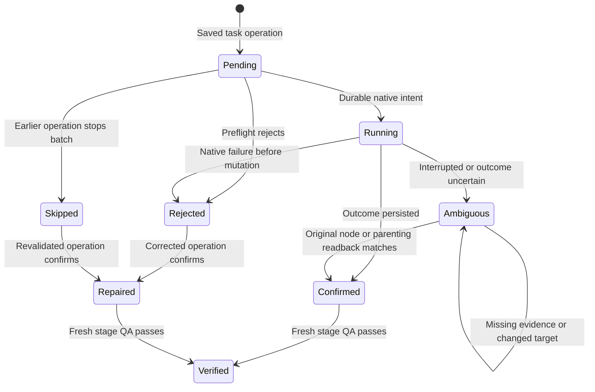
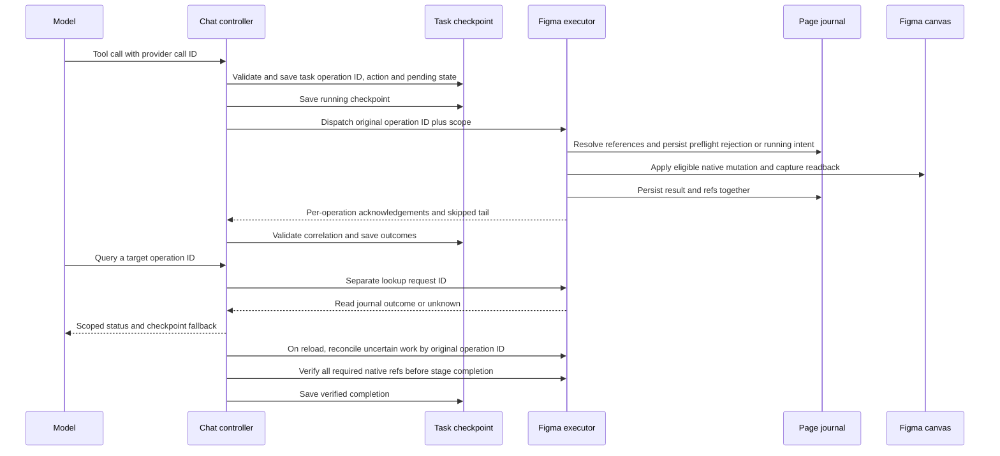

# Native partial commit recovery

## Incident and cause

The supplied Figma Desktop screenshot shows a lookup for `…-op-16`. The export identifies `…-op-17` as the ledger entry for a `get_operation_status` call. Before this fix, `runChatTask` numbered reads and mutations from the same ledger length and reported the request's assigned ID in failure diagnostics. `executeOperation` also stored status requests as if they were commands. The screenshot gives the target ID and the diagnostic gives the request's old ledger ID. Neither tells us the action or native node behind op-16. The round trace omits arguments and individual outcomes and cannot prove which round generated each ID.

The supplied counts show 15 attempted mutations, 12 confirmed, three rejected and zero ambiguous. Four failed ledger entries includes a non-mutation failure if the export and its totals are consistent. Three required refs were accounted for but no fresh verification ran. The two `too_big` errors in round 2 were tool schema validation during planning. A subsequent plan succeeded, and there is no evidence connecting those errors to the later native failure.

In `src/plugin/figma-tool-executor.ts`, task reference resolution could reject before saving any native status. The UI still recorded the rejection. An untouched batch tail could also lack a native record. The old status handler turned any missing native entry into an exception, and the UI categorized it as partial commit whenever the task already had committed mutations. The result was an inspection failure masking the earlier native rejection.

## States and ordering

`runChatTask` keeps status queries outside the mutation ledger and batch count. The native read does not allocate state, migrate storage, switch the visible page, or reuse cached results. A known rejection returns its saved reason. When native status is missing, the Chat checkpoint can establish a rejection or an operation that was not attempted. A legacy confirmation without native evidence remains blocked. A status response never upgrades a mutation on its own.

Figma storage and the canvas have no joint transaction. The single page record stores refs and outcomes together. The recovery boundaries are:

| Boundary                                               | Recovery behavior                                                                                                                                                                                                                                                          |
| ------------------------------------------------------ | -------------------------------------------------------------------------------------------------------------------------------------------------------------------------------------------------------------------------------------------------------------------------- |
| Before durable intent                                  | A storage failure stops before any canvas change. If both the native journal and acknowledgement are missing, the running checkpoint requires reconciliation.                                                                                                              |
| After durable intent, before or during native mutation | The journal reports running. The same ID may reconcile only from matching evidence. Absence of a node is insufficient to authorize another creation.                                                                                                                       |
| After creation, before outcome write                   | Recovery requires a unique node with the operation ID, logical ref, task ownership, action fingerprint, correct parent and node type, and a matching final properties fingerprint bound to that node ID. Legacy interrupted nodes without this fingerprint remain blocked. |
| After an interrupted parenting change                  | The original child and intended parent are checked. Recovery-only requests do not move the child.                                                                                                                                                                          |
| After outcome write, before UI acknowledgement         | Reload reads the same scoped outcome. Confirmed operations return their status without repeating native writes. A batch tail saved as not attempted is distinguished from an unknown attempt.                                                                              |
| Storage rejection, unreadable state or timeout         | The executor holds off later reads/writes while a timed-out write is still settling in that runtime. Invalid records are retained. If an outcome or skipped tail cannot be saved, the last durable record and native evidence govern recovery.                             |

The task checkpoint holds the pinned model, Brand Kit and Skills. New checkpoints also hold an opaque registration/account scope, stable across Companion restart. Active requests are fenced to the live Companion session and native dispatch is checked against the original document/page. Legacy checkpoints have no historical account proof and are bound to the active account on their first authorized continuation. Server and plugin processes cannot transact across a session change or across abrupt shutdown. An unresolved native outcome can require human inspection, particularly for property edits, missing creation metadata or changed native properties.

Mutation accounting partitions attempted entries into confirmed, rejected, ambiguous and verified no-op replays. Pending entries and known skipped operations are excluded. Historical query failures remain separately visible in diagnostics. A model cannot mark an ambiguous mutation repaired using a later same-tool call. Failed creations still block stage completion even when all required refs are present. The existing fresh native QA path applies the 5,000 node, depth 48 and 50,000 overlap pair bounds. Partial coverage cannot pass. Existing canvas placement retains the 6,000 px wrap width and 120 px gap.

## Acceptance

Mock evidence includes the reported counts, lookups for both IDs, quota failures at intent and outcome writes, changed readback, reload, and the three-screen 390 px RTL storefront with original IDs, no duplicates and 120 px separation. The source and Chat integrity tests cover the approved Chat markup and styles.

| Command                              | Local result                                                                                                                                                          |
| ------------------------------------ | --------------------------------------------------------------------------------------------------------------------------------------------------------------------- |
| `npm test -- --maxWorkers=1`         | 583 tests passed across 34 files                                                                                                                                      |
| `npm run typecheck`, `npm run lint`  | Passed                                                                                                                                                                |
| `npx tsc -p tsconfig.companion.json` | Passed                                                                                                                                                                |
| `npm run build`                      | Produced `dist/plugin.js` and `dist/ui.html`                                                                                                                          |
| `npm run verify:phase5`              | Confirmed the registered manifest, build entrypoints and loopback Companion startup                                                                                   |
| `git diff --check`                   | Passed                                                                                                                                                                |
| Focused Prettier                     | Checked new documentation and baseline-clean touched files. Formatted changed hunks in legacy files that already differed from Prettier. No repository-wide reformat. |

Live Figma Desktop recovery remains pending. The supplied screenshot and JSON document the original failure only. The existing Test Shop document was left untouched. For live acceptance, use a separately approved disposable file and authorized model session. Run the three-screen task, capture root and child IDs before interruption, reopen the saved History task after restart, resume once, and compare native values, IDs, count, spacing and the fresh QA result. Use the registered manifest at this checkout.
