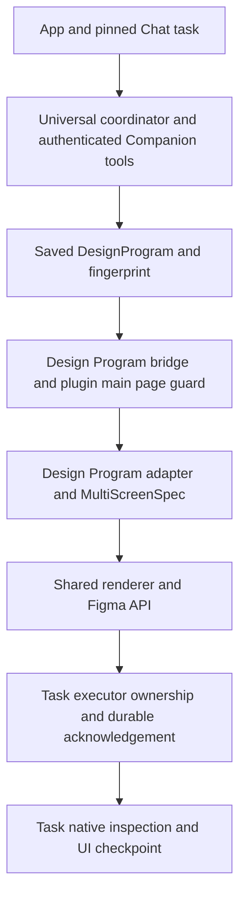

# Phase 5 native seam audit

Baseline checkout was clean on `main` at `1d0ff64`. The 703 tests across 41 files passed before editing. The registration verifier identified this checkout's manifest and booted the compiled Companion on loopback.

- P0. Universal completion checks viewport, scroll, types and counts in `universal-design-task.ts`. Descendant bounds and expected hierarchy are absent from this decision. The richer audit in `native-design-verification.ts` serves another generation route.
- P0. `renderMultiScreenDesign` identifies resumed roots by batch and screen ID. The Design Program seam verifies task ownership only after the renderer returns. Pending roots need scope proof before cleanup.
- P1. `design-program-adapter.ts` computes scroll extent from the declared height. Native paragraphs and nested layout can reflow independently of the declaration. The renderer's prototype scroll flag needs to be in place before geometry verification and before the completion marker.
- P1. `design-program.ts` checks fixed child totals only on the primary axis. It omits explicit minimum sizes from fill/hug and does not carry min/max constraints through the native adapter.
- Existing renderer capabilities include font enumeration/loading, style bindings, native component registry, asset preparation, and measured placement. The Design Program lacks component/instance definitions, wrap/grid intent and pinned overlays. Phase 4 host validation remains pending.

Source basis includes the Phase 2 adapter decision, Phase 3 route and ownership documentation, Phase 4 handoff, and the Phase 0 product contract. Installed Figma typings are the API floor. Desktop behavior remains a separate measurement.
